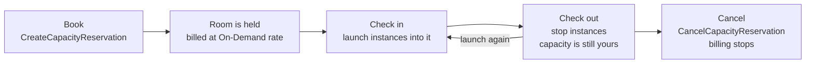
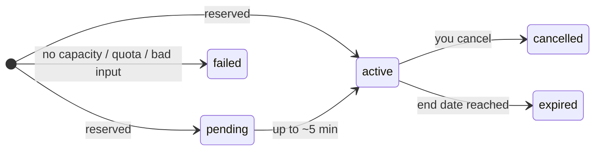
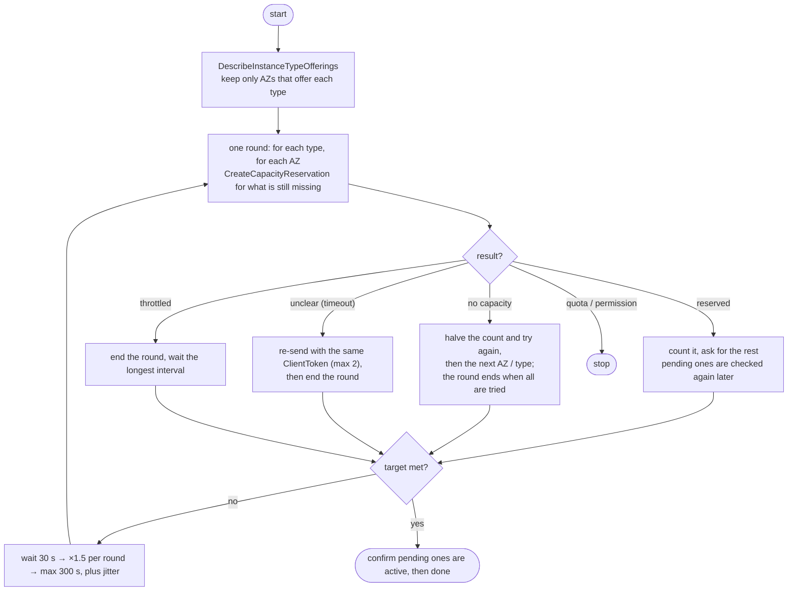

# gpu-hunter

**Sample code that explains how to use the EC2 On-Demand Capacity Reservation
(ODCR) APIs when GPU capacity is hard to get.**

> [!IMPORTANT]
> **This repo is for learning the APIs. It is not a tool to run as-is, and not for production.**
> The script is a worked example: read it to see how the API calls fit together,
> then write your own code for your own needs. It is not an official AWS tool and
> comes with no warranty ([LICENSE](LICENSE)).
> Capacity Reservations **cost money from the moment they exist**, used or not.
> The script refuses to create real reservations unless you pass
> `--i-understand-this-is-a-demo`.

[中文说明](README_CN.md) · [How it works, with diagrams (中文)](docs/MECHANISM.md)

---

## What you will learn

1. Why launching GPUs fails with `InsufficientInstanceCapacity`, and what you can do about it.
2. How an On-Demand Capacity Reservation works, and why it is better than retrying `run-instances`.
3. The **4 API calls** you need, with examples and the traps in each one.
4. How the sample script puts them together (retry, halve, change AZ / type, back off).
5. When to use the native **Capacity Reservation Fleet** instead.

## The idea in one picture

An ODCR is like booking a hotel room: once booked, the room is held for you, even
when nobody is in it, and you pay for it from the moment it is booked.



Compared with `run-instances`, the key difference is step D: **when the instance
stops, the reservation keeps the capacity.**

## Use the native option first

[Capacity Reservation Fleets](https://docs.aws.amazon.com/AWSEC2/latest/UserGuide/cr-fleets.html)
are managed by AWS: if capacity is short, the fleet keeps trying in the background
until it reaches the target, and it replaces reservations that get cancelled.
A fleet works in **one AZ only** (the API rejects several AZs) and supports
**`open` matching only**. This repo shows the lower-level API calls, which you would
use when you need several AZs, `targeted` matching, or your own logging.

---

## The 4 API calls

### 1. Where is the instance type offered? — `DescribeInstanceTypeOfferings`

```bash
aws ec2 describe-instance-type-offerings --region eu-central-1 \
  --location-type availability-zone \
  --filters Name=instance-type,Values=g6e.12xlarge \
  --query 'InstanceTypeOfferings[].Location' --output text
```

- Skip AZs that don't offer the type at all; asking there can never work.
- AZ names (`eu-central-1a`) map to different physical AZs in each account.
  Across accounts, use AZ IDs.

### 2. Reserve capacity — `CreateCapacityReservation`

```bash
aws ec2 create-capacity-reservation --region eu-central-1 \
  --instance-type g6e.12xlarge \
  --instance-platform Linux/UNIX \
  --availability-zone eu-central-1a \
  --instance-count 4 \
  --instance-match-criteria targeted \
  --end-date-type unlimited \
  --client-token "my-unique-id-0001" \
  --tag-specifications 'ResourceType=capacity-reservation,Tags=[{Key=purpose,Value=gpu-test}]' \
  --query 'CapacityReservation.[CapacityReservationId,State]' --output text
```

What to know:

| Topic | What happens | What to do |
|---|---|---|
| **All or nothing** | One call creates one reservation of exactly `--instance-count` (1–1000). No partial result. | On `InsufficientInstanceCapacity`, ask again for fewer (4 → 2 → 1). |
| **Failed attempts leave records** | Every no-capacity attempt leaves a reservation in state `failed`. Free, no quota, gone after 60 minutes. | Expect them in the console. |
| **Hidden CLI retries** | The CLI/SDK default is 3 attempts; in our test one no-capacity call left 3 `failed` records. | Set `AWS_MAX_ATTEMPTS=1` and control retries yourself. |
| **Lost responses** | A timeout doesn't tell you whether the reservation was created. | Send a `--client-token`. Re-sending the **same** token returns the original result; it never creates a second one (verified). |
| **Quota** | Reservations count against your On-Demand vCPU quota. | A quota error won't go away by retrying. Ask for a quota increase. |
| **`open` vs `targeted`** | `open` (default): any matching instance uses it, **including instances already running**. `targeted`: only instances that name it. | Use `targeted` if running instances of that type exist. |
| **Platform** | Must match the AMI's `PlatformDetails` (`Linux/UNIX` is not `Red Hat Enterprise Linux`). | Check the AMI first. |
| **Rate limit** | A mutating API. EC2 throttles mutating calls per account and Region with **one shared bucket** (50 tokens, refill 5/s at the time of writing). | Retry slowly with backoff and jitter. Fast loops also throttle the customer's own automation. |

### 3. Read the state — `DescribeCapacityReservations`

```bash
aws ec2 describe-capacity-reservations --region eu-central-1 \
  --filters Name=tag:purpose,Values=gpu-test Name=state,Values=active,pending \
  --query 'CapacityReservations[].[CapacityReservationId,InstanceType,AvailabilityZone,TotalInstanceCount,AvailableInstanceCount,State]' \
  --output text
```



- **`pending` is not a failure.** Because the API is eventually consistent, the
  state can take up to about 5 minutes to show `active`. Don't cancel it.
- A `pending` reservation can't be cancelled yet.
- Describe calls can lag behind a create; don't treat "not listed yet" as "not created".

### 4. Release — `CancelCapacityReservation`

```bash
aws ec2 cancel-capacity-reservation --region eu-central-1 \
  --capacity-reservation-id cr-0123456789abcdef0
```

- Billing is per second, **60 seconds minimum**, from the moment the reservation
  exists. An immediate-use reservation can be cancelled at any time for free.
- Running instances keep running after you cancel, at the normal On-Demand rate.

### Using the capacity

With `targeted`, name the reservation when you launch:

```bash
aws ec2 run-instances ... \
  --capacity-reservation-specification 'CapacityReservationTarget={CapacityReservationId=cr-0123456789abcdef0}'
```

---

## How the sample script puts the calls together

[`gpu-hunter.sh`](gpu-hunter.sh) (bash + AWS CLI v2) is a worked example of the
calls above in a retry loop.



Things the sample shows that are easy to get wrong:

- `pending` counts as reserved, and is checked again before reporting done.
- On an unclear result it sends **nothing new** in that round (a new token could
  double-book).
- Each round it re-reads what this run holds (tag `gpu-hunter-run`) and only ever
  **lowers** the remaining count, because describe can lag.
- One CSV line per attempt, so a run can be measured (`tools/report.sh`).

The full explanation, with sources for every fact and how to measure results, is in
[docs/MECHANISM.md](docs/MECHANISM.md) (Chinese).

## If you still want to try the sample

Only in a **test account**, and read the code first.

```bash
# see the API calls without creating anything
./gpu-hunter.sh -r eu-central-1 -t g6.xlarge -n 2 --dry-run

# real run: creates billed reservations, so the flag is required
./gpu-hunter.sh -r eu-central-1 -t g6.xlarge -n 2 --max-hours 1 --i-understand-this-is-a-demo

./gpu-hunter.sh -r eu-central-1 --status     # what it holds
./gpu-hunter.sh -r eu-central-1 --release    # cancel all of it (billing stops)
tools/report.sh                              # summary of the newest run
```

<details>
<summary>All options, exit codes, permissions</summary>

| Option | Meaning | Default |
|---|---|---|
| `-t, --types` | instance types, comma separated, in priority order | required |
| `-n, --count` | total instances wanted | 1 |
| `-r, --region` | Region | `$GPU_HUNTER_REGION`, else eu-central-1 |
| `-z, --azs` | only these AZs (names as seen in your account) | every AZ that offers the type |
| `-m, --min-chunk` | smallest reservation to request | 1 |
| `-i, --interval` / `--max-interval` | wait between rounds, seconds | 30 / 300 |
| `--max-hours` | stop after N hours (exit 4) | 0 = no limit |
| `-s, --sns` | SNS topic ARN for messages | none |
| `--targeted` | only instances that name the reservation can use it | `open` |
| `--platform` | must match the AMI's `PlatformDetails` | `Linux/UNIX` |
| `--tag` | value of the `gpu-hunter` tag, to keep runs apart | `gpu-hunter` |
| `--dry-run` | check only, create nothing | off |
| `--i-understand-this-is-a-demo` | required for a real (billed) run | off |

Exit codes: `0` target reached · `1` bad input, or real run without the demo flag ·
`2` no usable type/AZ · `3` fatal (quota, permission, parameters, listing failed) ·
`4` time limit · `130` stopped by signal. Reservations already made are **kept** on
every exit; release them with `--release`.

Environment: `GPU_HUNTER_REGION`, `GPU_HUNTER_LOG` (default `./gpu-hunter.log`),
`GPU_HUNTER_EVENTS` (default `./gpu-hunter-events-<run id>.csv`).

IAM: `ec2:CreateCapacityReservation`, `ec2:DescribeCapacityReservations`,
`ec2:CancelCapacityReservation`, `ec2:DescribeInstanceTypeOfferings`,
`ec2:CreateTags`; `sns:Publish` if you use `-s`.

</details>

## Repo layout

| Path | What it is |
|---|---|
| `gpu-hunter.sh` | the sample: the 4 API calls in a retry loop |
| `docs/MECHANISM.md` | how ODCR, throttling, retries and ClientToken work; diagrams; how to measure (Chinese) |
| `tools/report.sh` | summarises the per-attempt CSV of a run |
| `tests/test.sh` | offline tests with a fake `aws` CLI (`LIVE=1` adds one real `--dry-run`); about 30 s |

## License

MIT-0. See [LICENSE](LICENSE). Provided "as is", without warranty of any kind.
