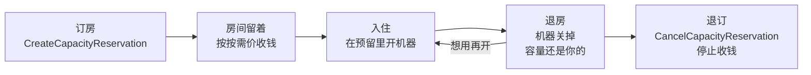
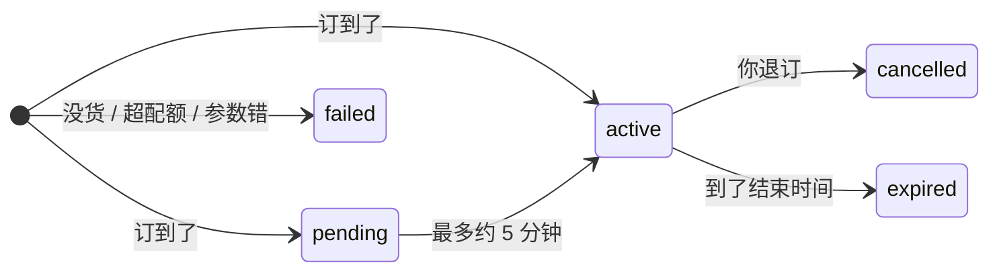
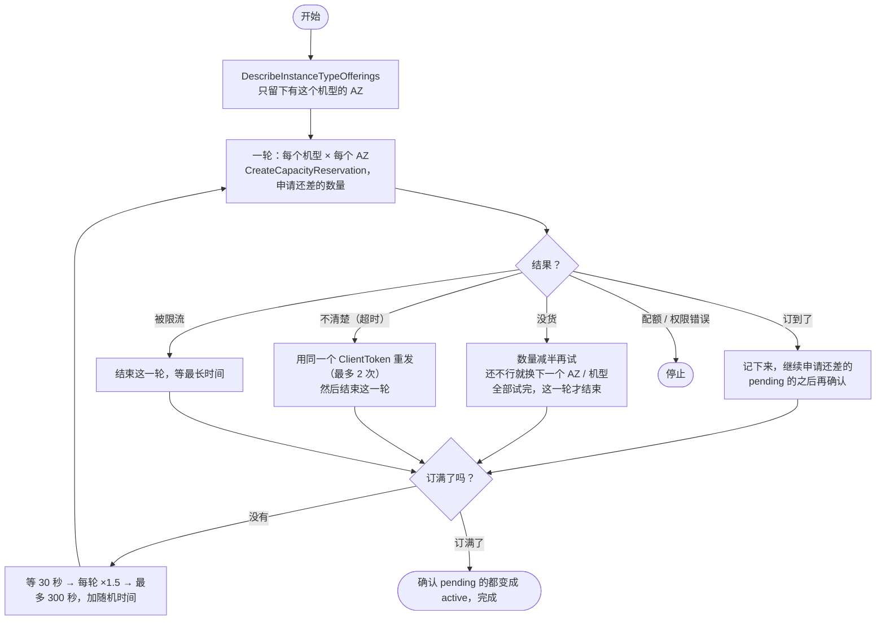

# gpu-hunter

**一个示例：GPU 很难开出来的时候，怎么用 EC2 按需容量预留（ODCR）的 API。**

> [!IMPORTANT]
> **这个仓库是用来学习 API 的，不是拿来直接运行的工具，也不能用在生产环境。**
> 脚本是一个讲解用的例子：读它，看这些 API 是怎么配合使用的，然后按自己的需要写自己的代码。
> 它不是 AWS 官方工具，不提供任何保证（见 [LICENSE](LICENSE)）。
> 容量预留**从创建那一刻起就收费**，用不用都收。
> 不加 `--i-understand-this-is-a-demo` 参数，脚本不会真的创建预留。

[English](README.md) · [机制详解（带流程图）](docs/MECHANISM.md)

---

## 读完能学到什么

1. 开 GPU 为什么会报 `InsufficientInstanceCapacity`，能怎么办。
2. 按需容量预留（ODCR）是怎么回事，为什么比反复 `run-instances` 好。
3. 需要的 **4 个 API**：怎么调用，每个有什么坑。
4. 示例脚本是怎么把它们串起来的：重试、减半、换 AZ / 机型、退避。
5. 什么时候应该用官方的 **Capacity Reservation Fleet**。

## 一张图看懂

ODCR 就像订酒店房间：订到了，房间就一直给你留着，没人住也留着；从订到那一刻起就开始收钱。



和 `run-instances` 比，最关键的区别是 D 这一步：**机器关了，容量还在。**

## 先考虑官方方案

[Capacity Reservation Fleet](https://docs.aws.amazon.com/AWSEC2/latest/UserGuide/cr-fleets.html)
由 AWS 托管：容量不够时会在后台一直重试，直到满足目标；预留被取消了还会自动补回来。
但它**只能在一个 AZ 里**（多个 AZ 时 API 会直接报错），**只支持 open 模式**。
这个仓库讲的是更底层的 API 调用，适合要多个 AZ、要 targeted 模式、或者要自己记录每次尝试的情况。

---

## 4 个 API

### 1. 这个机型在哪些 AZ 有？—— `DescribeInstanceTypeOfferings`

```bash
aws ec2 describe-instance-type-offerings --region eu-central-1 \
  --location-type availability-zone \
  --filters Name=instance-type,Values=g6e.12xlarge \
  --query 'InstanceTypeOfferings[].Location' --output text
```

- 没有这个机型的 AZ 直接跳过，去那里申请永远不会成功。
- AZ 名字（`eu-central-1a`）在每个账号里对应的物理机房不一样，跨账号要用 AZ ID。

### 2. 订容量 —— `CreateCapacityReservation`

```bash
aws ec2 create-capacity-reservation --region eu-central-1 \
  --instance-type g6e.12xlarge \
  --instance-platform Linux/UNIX \
  --availability-zone eu-central-1a \
  --instance-count 4 \
  --instance-match-criteria targeted \
  --end-date-type unlimited \
  --client-token "my-unique-id-0001" \
  --tag-specifications 'ResourceType=capacity-reservation,Tags=[{Key=purpose,Value=gpu-test}]' \
  --query 'CapacityReservation.[CapacityReservationId,State]' --output text
```

要知道的事：

| 主题 | 会发生什么 | 怎么做 |
|---|---|---|
| **要么全给，要么不给** | 一次调用只建一个预留，数量就是 `--instance-count`（1–1000），不会只给一部分 | 碰到 `InsufficientInstanceCapacity`，就少要一点再试（4 → 2 → 1） |
| **没订到也会留下记录** | 每次没货，都会留下一条 `failed` 状态的预留。不收钱、不占配额，60 分钟后消失 | 控制台里会看到，正常 |
| **CLI 会偷偷重试** | CLI/SDK 默认最多发 3 次；我们实测一次没货的调用留下了 3 条 `failed` 记录 | 设 `AWS_MAX_ATTEMPTS=1`，自己控制重试 |
| **回复丢了** | 网络超时的话，你不知道预留到底建没建 | 带上 `--client-token`。用**同一个** token 重发，AWS 会返回第一次的结果，不会再建一个（已实测） |
| **配额** | 预留占的是按需 vCPU 配额 | 配额错误重试多少次都没用，要申请提高配额 |
| **open 和 targeted** | open（默认）：对得上的机器都会用上它，**包括已经在跑的机器**；targeted：只有写明了它的机器才能用 | 账号里已经有同型号的机器在跑的话，用 targeted |
| **平台** | 要和 AMI 的 `PlatformDetails` 一样（`Linux/UNIX` 和 `Red Hat Enterprise Linux` 不是一回事） | 先查 AMI |
| **限流** | 这是"修改资源"类 API。EC2 按账号 + 区域给所有修改类 API **共用一个令牌桶**（写这篇时是 50 个，每秒补 5 个） | 慢慢重试，用退避 + 随机抖动。重试太快会连累客户自己的自动化程序 |

### 3. 查状态 —— `DescribeCapacityReservations`

```bash
aws ec2 describe-capacity-reservations --region eu-central-1 \
  --filters Name=tag:purpose,Values=gpu-test Name=state,Values=active,pending \
  --query 'CapacityReservations[].[CapacityReservationId,InstanceType,AvailabilityZone,TotalInstanceCount,AvailableInstanceCount,State]' \
  --output text
```



- **`pending` 不是失败。** 因为 API 是最终一致的，状态最多可能要约 5 分钟才显示 `active`。不要退掉它。
- `pending` 的预留暂时不能退订。
- 查询结果可能比创建慢一步：查不到，不等于没建成。

### 4. 释放 —— `CancelCapacityReservation`

```bash
aws ec2 cancel-capacity-reservation --region eu-central-1 \
  --capacity-reservation-id cr-0123456789abcdef0
```

- 从预留存在那一刻起**按秒收费，最少 60 秒**。立即生效的预留随时可以退，退订免费。
- 退订以后，正在跑的机器会继续跑，按普通按需价收费。

### 怎么用上订到的容量

targeted 模式下，开机时写明用哪个预留：

```bash
aws ec2 run-instances ... \
  --capacity-reservation-specification 'CapacityReservationTarget={CapacityReservationId=cr-0123456789abcdef0}'
```

---

## 示例脚本是怎么把这些 API 串起来的

[`gpu-hunter.sh`](gpu-hunter.sh)（bash + AWS CLI v2）就是把上面这些调用放进一个重试循环里的例子。



示例里演示了几个容易写错的地方：

- `pending` 算订到，但宣布完成之前会再确认一次。
- 结果不清楚的时候，这一轮**不再发新请求**（新 token 可能会重复订）。
- 每轮都会按 tag（`gpu-hunter-run`）重新查这次运行已经订到了多少，而且只用来**往下调**剩余数量，因为查询结果可能有延迟。
- 每次尝试都在 CSV 里记一行，方便衡量效果（`tools/report.sh`）。

完整的讲解见 [docs/MECHANISM.md](docs/MECHANISM.md)：每条事实都有出处，也讲了怎么评估效果。

## 如果还是想试一下示例

只在**测试账号**里试，而且先读一遍代码。

```bash
# 只看 API 调用，不创建任何东西
./gpu-hunter.sh -r eu-central-1 -t g6.xlarge -n 2 --dry-run

# 真的运行：会创建要收费的预留，所以必须加上这个参数
./gpu-hunter.sh -r eu-central-1 -t g6.xlarge -n 2 --max-hours 1 --i-understand-this-is-a-demo

./gpu-hunter.sh -r eu-central-1 --status     # 看订到了什么
./gpu-hunter.sh -r eu-central-1 --release    # 全部释放（停止收费）
tools/report.sh                              # 汇总最近一次运行
```

全部参数、退出码和需要的 IAM 权限，见 [README.md](README.md) 里的 "All options, exit codes, permissions"。

## 仓库里有什么

| 路径 | 是什么 |
|---|---|
| `gpu-hunter.sh` | 示例：把 4 个 API 放进重试循环 |
| `docs/MECHANISM.md` | ODCR、限流、重试、ClientToken 是怎么回事；流程图；怎么评估效果 |
| `tools/report.sh` | 汇总一次运行的逐次记录（CSV） |
| `tests/test.sh` | 离线测试，用假的 `aws` 命令（`LIVE=1` 会加一次真实的 `--dry-run`），大约 30 秒 |

## License

MIT-0，见 [LICENSE](LICENSE)。按"原样"提供，不提供任何形式的保证。
