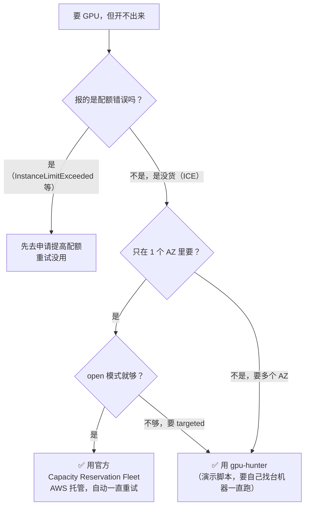
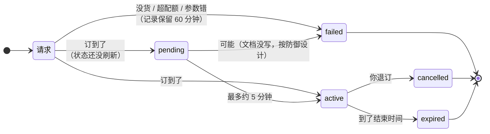
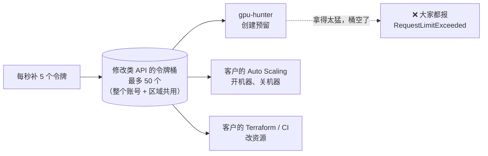
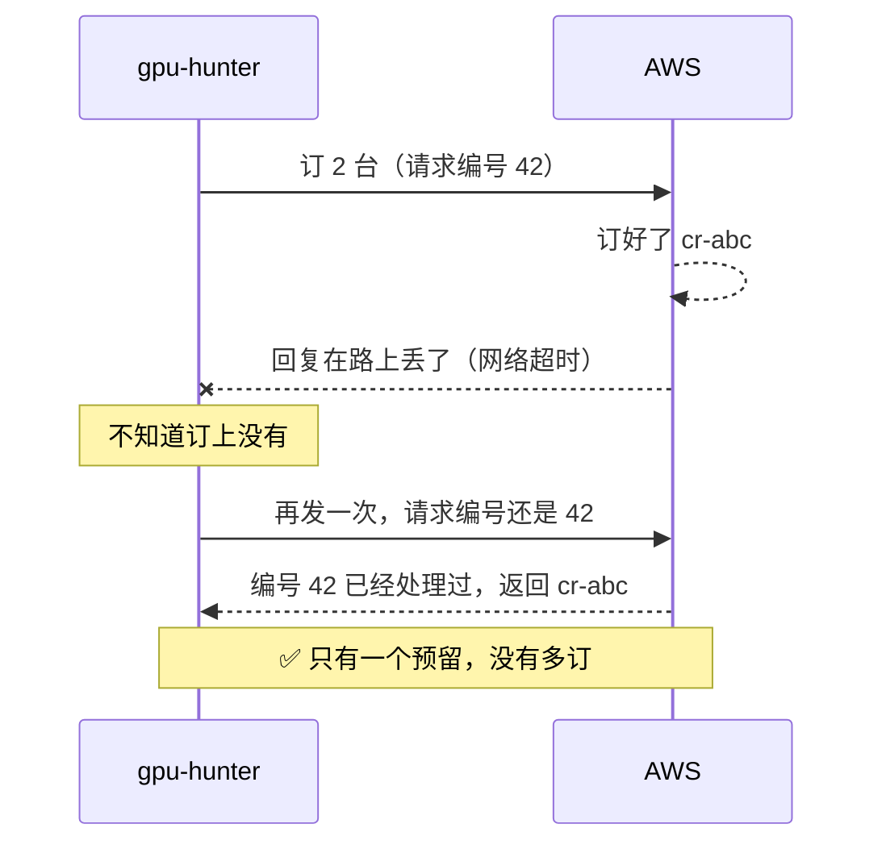
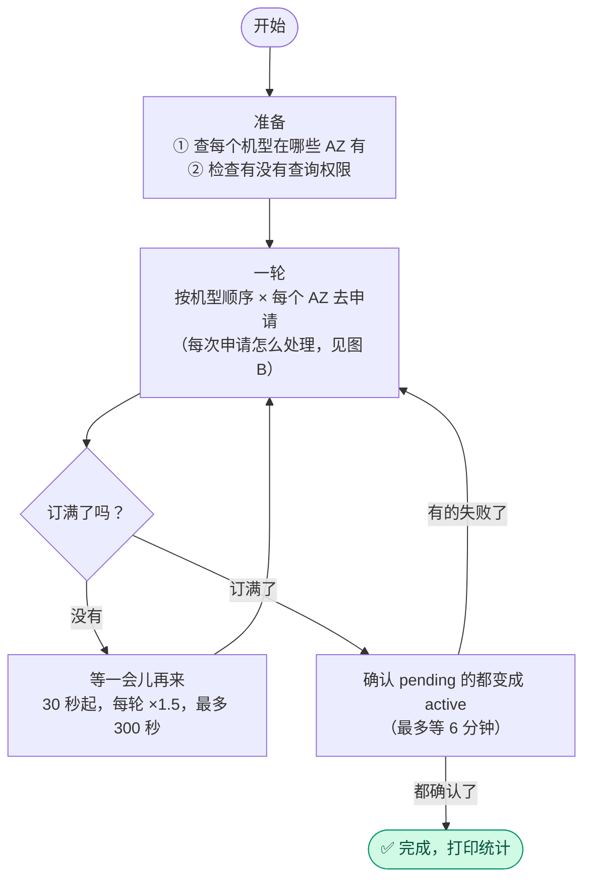
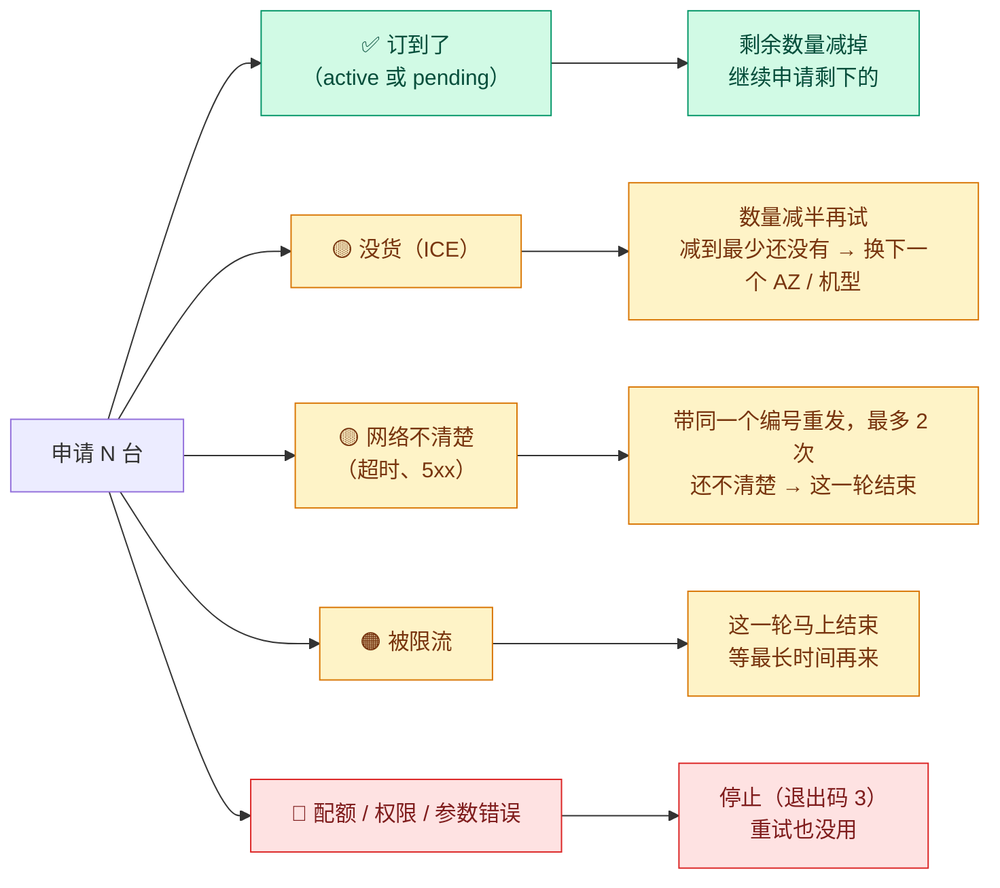

# 按需 GPU 容量预留（ODCR）机制详解

> ⚠️ **声明**：本文和本仓库的代码**只用于演示和学习**，不是 AWS 官方工具，也没有在生产环境验证过。
> **不要直接用在生产环境。** 文中的限制、价格、配额以 AWS 官方文档为准，这些内容会变。
> 最后核对日期：2026-11-10。

---

## 先看这里：三句话

1. **开不出 GPU，是因为 AWS 在那个机房暂时没有空的机器。** 能做的只有：过一会儿再试、换机房、换机型、少要几台。
2. **ODCR 就像提前订酒店房间**：订到了，房间就一直给你留着；但从订到的那一刻起就开始收钱，住不住都收。
3. **只在一个机房（AZ）里抢的话，先用 AWS 自带的 Capacity Reservation Fleet**；要同时在好几个机房里抢，再用 gpu-hunter。

### 我该用哪个？

### 来源标记

| 标记 | 意思 |
|---|---|
| 📄 | **AWS 官方文档**写的 |
| 🧪 | **我们自己调用 API 实测**的 |
| 💭 | 根据上面两种**推断**出来的，没有直接证据 |

---

## 术语表

| 术语 | 大白话 |
|---|---|
| **AZ**（可用区） | 一个区域里的一个机房。法兰克福有 3 个：1a、1b、1c |
| **ICE**（`InsufficientInstanceCapacity`） | "这个机房现在没有空的这种机器了" |
| **ODCR**（On-Demand Capacity Reservation，按需容量预留） | 先把某个机房里的机器"订下来"，不用马上开机 |
| **open 模式** | 订下的容量"**谁来都能用**"：只要机型、AZ 对得上，机器就会自动用上 |
| **targeted 模式** | 订下的容量"**只给报了订单号的人用**"：开机时要写明用哪个预留 |
| **配额**（quota） | 你的账号最多能同时用多少 vCPU。超过了就开不了，和有没有货无关 |
| **限流**（throttling） | 一秒钟内调用 API 太多次，AWS 会让你等一会儿再来 |
| **最终一致**（eventual consistency） | 刚改的东西，系统可能要过一会儿才显示成最新状态 |
| **ClientToken** | 给每个请求编一个号。同一个号重复发，AWS 只处理一次 |

---

## 1. 为什么开不出 GPU

> **一句话**：不是你做错了什么，是那个机房暂时没货。

- 报 **ICE**，意思是 **AWS 当时在这个 AZ 没有足够的按需容量**。📄
- 官方给的办法有四个 📄：
  1. **等几分钟再试**：官方原话是"容量变化很频繁"；
  2. **少要一点**：比如 15 台改成 3 次各要 5 台，或者 15 次各要 1 台；
  3. **换 AZ**；
  4. **换机型**。
- 还有一种失败**不是没货，是配额不够**：账号能用的 vCPU 已经到上限了。这种情况**再怎么重试都没用**，要去申请提高配额。📄

**gpu-hunter 做的事，就是把这四个办法自动化**：一直重试、拆小、换 AZ、换机型。

---

## 2. ODCR 是怎么工作的

> **一句话**：在某个 AZ 里，把某种机器先订下来；订到了就一直是你的，直到你取消。

### 2.1 订什么

ODCR 订的是：**某一个 AZ** 里的 **机型 + 操作系统平台 + 租户类型**，再加上**数量**。📄

> 比喻：在"法兰克福 1a 酒店"，订 4 间"g6e.12xlarge 标准间"。

- **订到了**：房间一直给你留着，**你不住也收钱**。
- **入住**：开机器，机器就"住进"订好的房间，这时只收机器的钱，不会重复收。
- **退房**（机器关掉）：**房间还是你的**，下次还能再住。这就是 ODCR 比直接开机器好的地方。
- **退订**（取消预留）：房间还给酒店，停止收钱。

### 2.2 两种 ODCR

| | **立即生效**（gpu-hunter 只用这种） | **未来日期**（future-dated） |
|---|---|---|
| 比喻 | 现在就要房间 | 提前预订下个月的房间 |
| 什么时候生效 | 订到马上生效 | 提前 5–120 天申请，到日期才生效 |
| 要不要承诺住多久 | **不用**，随时可以退，退了不收钱 | 要：C/G/I/M/R/T 系列至少 14 天，U/X 系列至少 12 周 |
| 支持哪些机型 | 所有支持的机型 | **只有 C、G、I、M、R、T、U、X 系列** |
| 最少订多少 | 1 台 | 加起来至少 32 个 vCPU |
| 退订 | 免费 | 承诺期内退订，要付 25%–50% 的费用 |

来源：📄 ODCR 概述、Create、Cancel 三篇文档

> **对 GPU 的意思**：G 系列（g5、g6、g6e、g7…）可以提前订；**P 系列（p4d、p5、p5en…）不能提前订**，只能现订。

### 2.3 谁能用订下的容量：open 和 targeted

- 机器要**机型、平台、AZ、租户类型四项都对上**，才能用这个预留。📄
- **open**（默认）：四项对上的机器**自动**用上预留。包括**新开的**，也包括**已经在跑的**，还包括 Auto Scaling、EKS、ECS、Batch 这些服务帮你开的机器。📄
- **targeted**：只有开机时**明确写了这个预留 ID** 的机器才能用。📄
- **平台要对上**：`Linux/UNIX` 和 `Red Hat Enterprise Linux` 算两种平台。要看 AMI 的 `PlatformDetails` 字段。📄

### 2.4 预留的状态

| 状态 | 大白话 |
|---|---|
| `pending` | 订到了，房间还在准备（**可能已经能住了**，见第 3 节） |
| `active` | 房间准备好了，可以住 |
| `failed` | 没订到：没货、超配额或者参数不对。**这条记录会保留 60 分钟** |
| `cancelled` | 你退掉了 |
| `expired` | 到了你设的结束时间，自动退掉了 |
| `assessing` / `scheduled` / `delayed` / `unsupported` / `cancelling` | 只有"未来日期"的预留才会出现，本工具用不到 |

来源：📄 View the state of a Capacity Reservation

> 读图：我们想要的路是 **请求 → pending → active**，或者直接 **请求 → active**。`pending` 不能退订，要等它变成 `active` 才能退。

### 2.5 怎么收钱

> **一句话**：订到就开始按按需价收钱，用不用都收；机器用上了就不会重复收。

- 按**按需价格**收费，**有没有机器在用都收**。📄
- 机器用上了预留以后，**只收机器的钱**，不会再另外收预留的钱。📄
  例子：订了 20 台，只开了 15 台 → 付 15 台在用的钱 + 5 台空着的钱。📄
- **按秒计费，最少收 60 秒**。所以订到马上退，也至少收 60 秒的钱。📄
- 折扣：**Savings Plans** 和**区域型 RI** 的折扣对预留有效；**可用区型 RI 的折扣无效**。📄
- 退订：立即生效的预留**随时可以退，退了不收钱**。退订以后，正在跑的机器**不会被关掉**，会按普通按需价继续收费。📄

### 2.6 配额

- 预留占的是**按需 vCPU 配额**，和开机器用的是同一份额度。📄
- 能订多少 = 配额 − 正在跑的机器。处于 `pending`、`active` 等状态的预留都会占配额。📄
  例子：配额是 192 vCPU，已经跑着 96 vCPU 的机器，那就最多还能再订 1 台 p4d.24xlarge（96 vCPU）。
- 一次请求的数量：**1 到 1000 台**。📄

### 2.7 一次请求：要么全给，要么不给

- 一次请求只会建**一个**预留，数量就是你请求的数量。📄
- **没有**"有几台给几台"的选项。💭 API 里没有这样的参数，实测碰到 ICE 时也没有拿到过部分数量。
- 所以想拿到一部分，**只能自己把请求拆小**。官方排障文档也是这么建议的。📄

> 比喻：订 4 间房，酒店只剩 2 间，系统不会给你 2 间，而是直接说"订不了"。你得自己改成订 2 间再试。

### 2.8 AZ 名字在每个账号里不一样

- 同一个名字，比如 `eu-central-1a`，在**不同账号里对应的物理机房是随机的**。📄
- 想跨账号说清楚是哪个机房，要用 **AZ ID**，比如 `euc1-az2`。📄
- 给客户写操作步骤时，如果涉及多个账号，**一定要用 AZ ID**。

---

## 3. 三个最容易踩的坑

### 坑 1：`pending` 不等于失败

- 因为**最终一致**，订到以后，状态**最多可能要 5 分钟**才显示成 `active`。这段时间显示 `pending`，但**可能已经能用了**。📄
- `pending` 状态的预留**不能退订**，只有 `active` 等状态才能退。📄
- ✅ 正确做法：`pending` 也算订到，**千万不要因为它一直是 pending 就去退掉**。
- ✅ 但也**不能一订到就宣布成功**：💭 官方文档没有说 `pending` 一定会变成 `active`，所以我们按"可能会失败"来设计（防御性做法，没有实际遇到过）。gpu-hunter 会记下所有 pending 的预留，之后再查；变成 `failed` 的话，就把数量加回去**继续抢**；宣布"抢满"之前，最多等 6 分钟让结果出来。
- 🐛 我们的代码在这里犯过两次错：
  1. 等 60 秒还不是 active 就退掉，可能把**已经抢到的容量又还回去**；
  2. 改掉第 1 个错以后，又变成一订到就算数，pending 后来失败了也会**报告"抢满了"，但其实一台都没有**。

  两个都已经修好，也都有测试。

### 坑 2：没抢到，也会留下记录

- 🧪 每次 ICE，账号里都会多一条 **`failed` 状态的预留记录**，打的 tag 也会带上。
- 这些记录**不收钱**，**不占配额**（官方列出的占配额状态里没有 `failed`）📄，**60 分钟后就看不到了**。📄
- 影响：重试得越多，控制台里的 `failed` 记录越多，看起来会比较乱。

### 坑 3：open 模式会把正在跑的机器"吸"进来

- 账号里如果**已经有**同机型、同 AZ 在跑的机器，预留一生效，这些机器就会**马上占掉它**。📄
- 结果：你以为抢到了 4 台的容量，其实被现有的机器用掉了，新机器还是开不出来。
- ✅ 不想这样的话，用 **targeted 模式**（gpu-hunter 加 `--targeted`）。

---

## 4. API 的限流和重试

> **一句话**：问得太勤会被 AWS 限流，而且会连累客户自己的其他程序；CLI 还会在你看不到的地方偷偷重试。

### 4.1 限流：像一个装令牌的桶

- EC2 按**账号 + 区域**来限流。📄
- 原理：每个 API 有一个"**令牌桶**"，每调用一次拿走一个令牌；桶空了就会报 `RequestLimitExceeded`；桶会按固定速度补令牌。📄
- 创建预留（`CreateCapacityReservation`）属于"**修改资源**"类 API：**桶里最多 50 个令牌，每秒补 5 个**。📄
- ⚠️ **这个桶是账号里所有"修改资源"的 API 一起用的**，不是创建预留单独一个。📄
  → 抢得太猛，**客户自己的 Auto Scaling、Terraform、CI 也会跟着被限流**。
- "查询"类 API（`Describe*`）用另一个桶：最多 100 个，每秒补 20 个。📄

- 官方建议：失败后**等待时间越来越长**（指数退避），再**加一点随机时间**（抖动），并且设一个最长等待时间。📄

### 4.2 CLI 会偷偷重试

- AWS SDK 和 CLI v2 默认最多发 **3 次**（第一次 + 最多 2 次重试）；设成 1 就不重试。📄
- 🧪 实测：默认设置下，一次没抢到，账号里会留下 **3 条** `failed` 记录。我们一共试了 5 个"机型 × AZ"组合，正好留下 15 条。
  💭 说明 CLI **把 ICE 当成了可以重试的错误**，在我们看不到的地方又发了 2 次。
- 问题：这些看不到的重试会**打乱我们自己的节奏**，还会**多用令牌**。
- ✅ 所以 gpu-hunter 设了 `AWS_MAX_ATTEMPTS=1`，什么时候重试由脚本自己决定。

### 4.3 网络断了怎么办：ClientToken

- 情况：请求发出去了，网络突然断了，**你不知道 AWS 到底有没有帮你订上**。
  - 不重发：可能真没订上，白白错过；
  - 直接重发：可能已经订上了，再订一次就**多订了、多花钱**。
- 解决：每个请求带一个 **ClientToken**（请求编号）。**同一个编号重复发，AWS 只会处理一次**，第二次直接返回第一次的结果。📄

如果连续 2 次重发都还是不清楚，gpu-hunter **这一轮就不再发新请求**（新请求会用新编号，可能多订），等下一轮先去 AWS 查一下这次运行已经订到多少，再继续。
- 🧪 实测：同一个 ClientToken 连发两次，**两次返回同一个预留 ID**，账号里也只有一个预留。
- ✅ gpu-hunter 碰到网络超时这类"不知道成没成功"的错误，会**带同一个编号再发**，最多 2 次。

---

## 5. 官方方案：Capacity Reservation Fleet

> **一句话**：AWS 自己就有"自动一直重试"的功能，但只能在一个 AZ 里用。

| | **Capacity Reservation Fleet**（官方） | **gpu-hunter**（演示） |
|---|---|---|
| 没容量时 | **AWS 在后台自动一直重试**，直到满足目标 📄 | 脚本循环重试 |
| 抢满以后被取消了 | **会自动补回来** 📄 | 不会 |
| 多个机型 | 可以，按优先级 📄 | 可以，按你给的顺序 |
| **多个 AZ** | ❌ **不行**。🧪 API 直接报错："All InstanceTypeSpecifications must specify the same Availability Zone" | ✅ 可以 |
| open / targeted | 只支持 open 📄 | 两种都支持 |
| 按 vCPU 等权重算容量 | 支持 📄 | 不支持，只按台数 |
| 前提 | 第一次用要先建一个 service-linked role（需要 `iam:CreateServiceLinkedRole` 权限）🧪 | 不需要 |
| 谁来跑 | **AWS 托管**，你不用管 | 要自己找台机器一直开着跑 |
| 额外费用 | 不收 📄 | 不收（只收预留本身的钱） |

**怎么选**
- **只要一个 AZ、open 模式就够** → **先用官方 Fleet**。AWS 托管，被取消了还会自动补回来。
- **要多个 AZ 一起找、要 targeted、或者要每次尝试的记录** → 用 gpu-hunter。
- 也可以**每个 AZ 建一个 Fleet**。💭 我们没有测过多个 Fleet 同时跑的效果。

> 说明：我们的测试账号没有权限创建 service-linked role，所以 **Fleet"后台自动重试"的效果没有实测**，上面写的都来自官方文档。

---

## 6. gpu-hunter 是怎么做的

> **一句话**：按顺序在每个机型、每个 AZ 里去订；订不到就拆小、换地方、等一会儿再来，直到订满。

### 6.1 流程

**图 A：整体，一轮一轮地抢**

每轮开始时还会做两件"对账"的小事：复查 pending 的预留；去 AWS 查一下这次运行实际订到了多少（只用来往下调剩余数量）。

**图 B：一次申请之后，看结果怎么办**

### 6.2 每个设计对应哪条机制

| 机制 | gpu-hunter 的做法 |
|---|---|
| 官方建议换 AZ、换机型 📄 | 按你给的机型顺序，在每个有这个机型的 AZ 里都试；先查掉根本没有的组合 |
| 一次请求要么全给要么不给 📄💭 | 没货就**减半**再试，能订几台先订几台 |
| 容量变化很频繁 📄 + 令牌桶是共用的 📄 | 等待时间越来越长，加随机时间 |
| CLI 会偷偷重试 🧪 | `AWS_MAX_ATTEMPTS=1`，由脚本自己决定什么时候重试 |
| `pending` 可能要 5 分钟才变 `active` 📄 | **不退 pending 的预留**；只有返回 `failed` 才算没订到 |
| 网络断了不知道成没成功 | 带**同一个 ClientToken** 最多再发 2 次 🧪；还是不清楚的话，**这一轮不再发新请求** |
| 被限流 📄 | **这一轮马上结束**，等最长时间再来，不再继续消耗共用的令牌 |
| 💭 `pending` 可能失败（文档没说一定成功） | 记下 pending 的预留，之后复查；失败的把数量加回去继续抢；宣布完成前最多等 6 分钟 |
| 响应丢了的兜底 | 每轮按 tag（`gpu-hunter-run`）去 AWS 查已经订到多少。因为查询结果可能有延迟，这个数字**只用来往下调剩余数量，不会往上调**，避免多订 |
| `pending` 不能退订 📄 | `--release` 失败时提示"过几分钟再运行一次" |
| 配额错误重试没用 📄 | 碰到配额、权限、参数错误马上停（退出码 3） |
| 没有查询权限就没法核对 | 开始前先检查 `DescribeCapacityReservations` 权限 |
| 按秒收钱，不用也收 📄 | 每个预留都打 tag，`--status` 查看，`--release` 一键释放 |
| open 模式会吸走正在跑的机器 📄 | 提供 `--targeted` |

---

## 7. 速度

> **一句话**：每次请求大约 1 秒多，一轮几十秒；能不能抢到，主要看 AWS 那边什么时候空出机器。

### 7.1 每次请求要多久 🧪

测试环境：在**东京区域**的一台开发机上，用 AWS CLI v2 调用。

| 调用 | 调法兰克福（跨区域） | 调东京（本区域） |
|---|---|---|
| 创建预留，`--dry-run`（只检查不创建） | 1275–1352 毫秒（8 次） | 没测 |
| 真实创建一个 t3.micro 预留 | 约 1490 毫秒（3 次），**响应里直接就是 `active`** | 没测 |
| 查询预留 | 1261–1333 毫秒 | **约 395 毫秒** |
| 只启动 CLI（`aws --version`） | 约 160 毫秒 | |

**结论**
- 跨区域调用时，每次大约有 **1 秒花在路上**。
- **在目标区域里运行**（比如用 CloudShell，或者在那个区域开一台小机器），每次请求预计能从 1.3 秒降到 0.4 秒左右。💭 这是根据本区域查询的数据推出来的，本区域的创建请求没有单独测过。

### 7.2 一轮要多久

一轮最多发的请求数 ≈ **机型数 × AZ 数 × 减半次数**，减半次数 ≈ log₂(数量) + 1。

例子：2 个机型 × 3 个 AZ × 要 8 台（8 → 4 → 2 → 1，减半 4 次）= **24 次请求**
- 跨区域：24 × 1.4 秒 ≈ **34 秒**
- 本区域：24 × 0.4 秒 ≈ **10 秒** 💭
- 平均每秒不到 1 次请求，远低于每秒补 5 个令牌的速度，**不会把客户的令牌桶用光**。💭
- 每轮之间还要再等 30–300 秒。

### 7.3 什么决定了"抢得快不快"

- **最主要的：AWS 什么时候空出机器**（别的用户关机、AWS 加机器）。这个脚本控制不了。💭
- **脚本能控制的**：
  1. **多快发现**空出来的机器：检查得越勤，越容易发现；
  2. **覆盖多少地方**：机型和 AZ 越多，机会越大；
  3. **能不能先拿一部分**：靠减半。
- **不是越勤越好**：会用掉共用的令牌，还会留下大量 `failed` 记录。默认的 30–300 秒是比较保守的起点，**没有经过大规模验证**。

---

## 8. 怎么判断效果好不好

> **一句话**：最重要的是"多久抢满"；而且要和基线比，不能只看一次的结果。

### 8.1 每次运行会记录什么

1. **事件文件** `gpu-hunter-events-<run id>.csv`（每次运行一个文件）：每次请求记一行。
   - 字段：时间、已运行秒数、第几轮、机型、AZ、请求数量、结果、API 耗时
   - 结果可能是：`won-active`、`won-pending`（订到）、`no-capacity`（没货）、`failed-state`、`throttled`（被限流）、`aws-or-network-error`、`quota`、`fatal`、`dry-run`
2. **结束时打印一行统计**：订到几台、用了多久、跑了几轮、请求了几次、成功几次、没货几次、被限流几次、第一次订到用时、订满用时。
3. **汇总工具**：`tools/report.sh gpu-hunter-events-<run id>.csv`，按"机型 × AZ"列出请求次数、成功率、平均耗时，还有耗时的中位数和 p90。

### 8.2 看哪些指标

| 指标 | 怎么算 | 说明什么 |
|---|---|---|
| ⭐ **订满用时** | 开始 → 订满目标 | **最重要**：整体效果 |
| **第一次订到用时** | 开始 → 第一次订到 | 最快多久能开始干活 |
| **完成率** | 订到台数 ÷ 目标台数（按时间看变化） | 订不满时能拿到多少 |
| **几次请求换一次成功** | 请求次数 ÷ 成功次数 | 效率，也代表用了多少令牌 |
| **各机型 × AZ 的成功率** | 看 report.sh 的表 | 哪里更好抢，下次排前面 |
| **被限流次数** | `throttled` 的个数 | **应该是 0**；不是 0 就把间隔调大 |
| **闲置成本** | (预留的台时 − 实际在用的台时) × 按需单价 | 订到了没用上，浪费了多少钱 |

看闲置成本：CloudWatch 里有预留的指标，`InstanceUtilization`（使用率）、`UsedInstanceCount`、`AvailableInstanceCount`。使用率低于 20% 时，AWS Health 还会发出 `AWS_EC2_ODCR_UNDERUTILIZATION_NOTIFICATION` 事件，可以用 EventBridge 接收。📄

### 8.3 怎么对比才公平

容量**一直在变**：同样的设置，今天和明天的结果可能差很多。所以：

1. **要有基线**。比如"人工每 10 分钟在控制台点一次"或者"固定每 60 秒、只试一个 AZ"，拿**订满用时**来比。
2. **轮流跑**。A、B 两种设置交替跑（A 一小时、B 一小时，重复几次），不要一个只在白天跑、另一个只在晚上跑。
3. **不要在同一个账号里同时跑两种设置**：它们会互相抢同一批机器，还会共用一个令牌桶。
4. **每种设置多跑几次**，看中位数，不要只看一次。
5. **和官方 Fleet 比**：在同一个 AZ、同一个机型上，分别用 Fleet 和 gpu-hunter，比订满用时。（我们还没做过。）
6. **样本少的时候不要下结论**：一两次的结果波动很大。

---

## 9. 验证过什么，没验证过什么

### ✅ 验证过

| 测试 | 结果 |
|---|---|
| 25 个离线测试：用一个"假的 aws 命令"模拟没货、`failed`、`pending` 后来失败、响应丢失、一直超时、被限流、查询延迟、配额、没权限、参数错误等。每个修过的 bug 都有测试，并确认过**旧代码会失败、新代码通过** | 全部通过 |
| 用真实 API 跑 `--dry-run` | 通过 |
| 真实创建 → `--status` 查看 → `--release` 释放（t3.micro） | 通过 |
| 真实测试 ClientToken | 同一个编号发两次，拿到同一个 ID |
| 真实的"机型优先级换位" | g6e.12xlarge 在法兰克福 1a 真的没货（ICE，要 2 台和减半后的 1 台都没有），脚本自动换到第二个机型，订到了 |
| 区域写错 / 查询失败时 `--status` | 明确报错，退出码 3 |
| 在一个测试 VPC 的私有子网里抢 1 台 g6.xlarge | 第一轮碰到真实的 ICE；开始后约 45 秒订到；在预留里开机器，**自动用上了预留**；`nvidia-smi` 显示 NVIDIA L4；机器关掉以后**预留还在**；释放成功 |

### ❌ 没验证过

- 大数量（几十台以上）
- P 系列（p4d、p5、p5en）的真实抢购
- 连续跑很多个小时
- 官方 Fleet 的实际效果，以及和 gpu-hunter 的对比

---

## 10. 风险和局限

| 风险 | 说明 |
|---|---|
| **不保证能抢到** | 机器是 AWS 的，脚本只能提高"发现空机器"的机会 |
| **会花钱** | 订到就按按需价收钱，用不用都收，最少 60 秒。**用完一定要 `--release`** |
| **open 模式会吸走正在跑的机器** | 见第 3 节坑 3 |
| **会用掉共用的令牌** | 见第 4.1 节，间隔不要调得太小 |
| **会留下 `failed` 记录** | 不收钱，60 分钟后消失，但控制台会比较乱 |
| **脚本退出后就不管了** | 不像官方 Fleet，预留被取消了不会自动补回来 |
| **只是演示代码** | 用 bash 写的，没有生产级别的错误处理、监控和审计 |

---

## 参考资料（AWS 官方文档）

| 主题 | 链接 |
|---|---|
| ODCR 概述 | [Reserve compute capacity with EC2 On-Demand Capacity Reservations](https://docs.aws.amazon.com/AWSEC2/latest/UserGuide/ec2-capacity-reservations.html) |
| 创建 | [Create a Capacity Reservation](https://docs.aws.amazon.com/AWSEC2/latest/UserGuide/capacity-reservations-create.html) |
| 状态 | [View the state of a Capacity Reservation](https://docs.aws.amazon.com/AWSEC2/latest/UserGuide/capacity-reservations-view.html) |
| 计费 | [Capacity Reservation pricing and billing](https://docs.aws.amazon.com/AWSEC2/latest/UserGuide/capacity-reservations-pricing-billing.html) |
| 退订 | [Cancel a Capacity Reservation](https://docs.aws.amazon.com/AWSEC2/latest/UserGuide/capacity-reservations-release.html) |
| 创建 API | [CreateCapacityReservation](https://docs.aws.amazon.com/AWSEC2/latest/APIReference/API_CreateCapacityReservation.html) |
| 官方 Fleet | [Capacity Reservation Fleets](https://docs.aws.amazon.com/AWSEC2/latest/UserGuide/cr-fleets.html) · [概念](https://docs.aws.amazon.com/AWSEC2/latest/UserGuide/crfleet-concepts.html) |
| 限流 | [Request throttling for the Amazon EC2 API](https://docs.aws.amazon.com/ec2/latest/devguide/ec2-api-throttling.html) |
| 重试 | [Retry behavior (AWS SDKs and Tools)](https://docs.aws.amazon.com/sdkref/latest/guide/feature-retry-behavior.html) |
| 开机排障 | [Troubleshoot Amazon EC2 instance launch issues](https://docs.aws.amazon.com/AWSEC2/latest/UserGuide/troubleshooting-launch.html) |
| 监控 | [CloudWatch 指标](https://docs.aws.amazon.com/AWSEC2/latest/UserGuide/capacity-reservation-cw-metrics.html) · [使用率过低提醒](https://docs.aws.amazon.com/AWSEC2/latest/UserGuide/cr-eventbridge.html) |
| AZ ID | [Availability Zone IDs](https://docs.aws.amazon.com/ram/latest/userguide/working-with-az-ids.html) |
